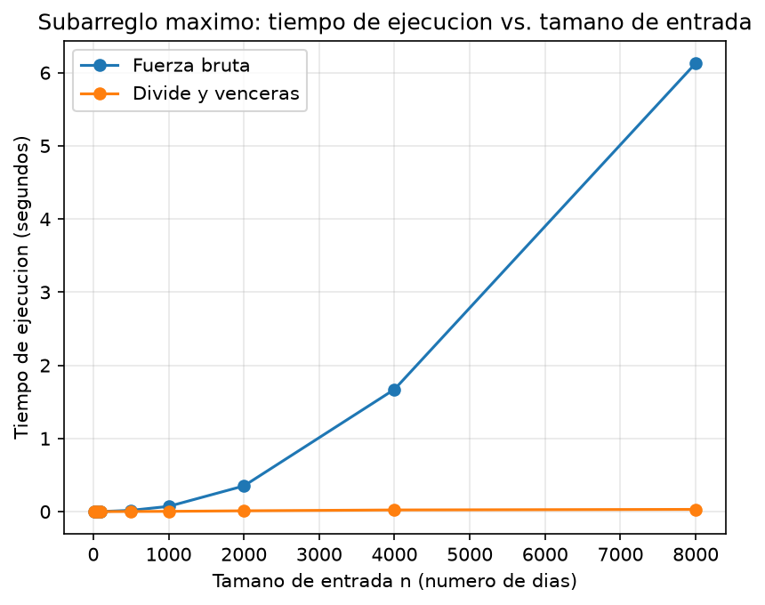

# Laboratorio evaluativo 02 — Dividir y vencer

**Nombre completo:** DAVID MORALES VARGAS

## Instrucciones para reproducir el experimento

1. Ubicarse en la raíz del repositorio del curso y crear el entorno virtual (solo la primera vez):
   ```bash
   python -m venv venv
   ```
   ó (en Windows, si `python` no está en el PATH)
   ```bash
   py -m venv venv
   ```
2. Activar el entorno virtual:
   - Linux/macOS: `source venv/bin/activate`
   - Windows: `venv\Scripts\activate`
3. Instalar las dependencias (como `matplotlib`):
   ```bash
   pip install -r requirements.txt
   ```
4. Entrar a la carpeta del laboratorio:
   ```bash
   cd laboratorios/lab2-divide-y-vencer
   ```
5. Ejecutar las pruebas (el script termina imprimiendo `Todas las pruebas pasaron.`):
   ```bash
   python pruebas.py
   ```
   ó `py pruebas.py` (Para Windows)
6. Ejecutar la medición (imprime los tiempos y genera `graficas/tiempo_vs_n.png`):
   ```bash
   python medicion.py
   ```
   ó `py medicion.py` (Para Windows)

---

## Parte 1: Implementar y verificar las dos soluciones

Código de esta parte: [`subarreglo.py`](subarreglo.py) y [`pruebas.py`](pruebas.py)

Las tres funciones están en [`subarreglo.py`](subarreglo.py):

- [`subarreglo_fuerza_bruta`](subarreglo.py#L4-L31): prueba todos los pares de días `(i, j)` acumulando la suma dentro del ciclo.
- [`suma_cruzada`](subarreglo.py#L34-L69): barrido lineal desde el punto medio hacia cada lado, para el tramo que incluye al menos un día de cada mitad.
- [`subarreglo_maximo`](subarreglo.py#L72-L102): divide y vencerás; resuelve los casos izquierdo, derecho y cruzado y devuelve el mejor de los tres, sin llamar a la fuerza bruta.

**Cómo se verificó.** El script [`pruebas.py`](pruebas.py) usa `assert` (instrucción en Python que permite comprobar que una condición proporcionada sea verdadera. Se usa para hacer pruebas unitarias) y compara siempre la suma, no los índices. Casos cubiertos:

- La serie de ocho días de la situación problema (suma `17`, días 2 a 7).
- Una serie de un solo elemento (positivo y negativo).
- Una serie con todos los valores negativos (el mejor tramo es el elemento menos negativo).
- Una serie con todos los valores positivos (el mejor tramo es la serie completa).
- Un caso donde el mejor tramo cruza el punto medio (`[-5, 2, 3, 4, 5, -6]`, tramo de los índices 1 a 4).
- Que las funciones no modifican la lista recibida.
- 30 listas aleatorias (con semilla fija), en las que ambas funciones deben dar la misma suma.

---

## Parte 2: Medir y graficar

Código de esta parte: [`medicion.py`](medicion.py)

**Cómo se midió:**

- Tamaños de entrada ([`TAMANOS`](medicion.py#L14)): 10, 50, 100, 500, 1000, 2000, 4000 y 8000.
- Datos generados por [`generar_datos`](medicion.py#L20-L30) con semilla fija ([`SEMILLA = 42`](medicion.py#L15)), enteros entre -100 y 100. Para cada tamaño se usa la **misma lista** en ambos algoritmos.
- Solo se cronometra la llamada al algoritmo, con `time.perf_counter()`; la generación de datos queda fuera.
- Cada medición se repite 3 veces ([`REPETICIONES`](medicion.py#L16)) y se reporta la **mediana**.
- Dentro del propio experimento ([`medir`](medicion.py#L51-L84)) se verifica con `assert` que ambos algoritmos devuelven la misma suma en cada tamaño.



**Tiempos medidos (segundos, mediana de 3 repeticiones):**

| n | Fuerza bruta (s) | Divide y vencerás (s) |
|---:|---:|---:|
| 10 | 0.000015s | 0.000025s |
| 50 | 0.000226s | 0.000164s |
| 100 | 0.000790s | 0.000309s |
| 500 | 0.017496s | 0.001845s |
| 1000 | 0.071589s | 0.003832s |
| 2000 | 0.351359s | 0.011200s |
| 4000 | 1.671757s | 0.022761s |
| 8000 | 6.129756s | 0.030714s |

---

## Parte 3: Análisis

### 1. Recurrencia

Código relacionado: [`subarreglo_maximo`](subarreglo.py#L72-L102), [`suma_cruzada`](subarreglo.py#L34-L69) y [`subarreglo_fuerza_bruta`](subarreglo.py#L4-L31).

La función `subarreglo_maximo` realiza dos llamadas recursivas, una por cada mitad, cada una sobre n/2 elementos. La función `suma_cruzada` no es recursiva: los dos barridos que hace desde el punto medio recorren el rango una sola vez, entonces eso significa un Θ(n). Combinar es comparar las tres sumas, Θ(1), así que:

`T(n) = 2T(n/2) + Θ(n)`

Usando el método maestro: a = 2, b = 2, `n^(log_2 2) = n`. Como f(n) = Θ(n) = Θ(n^(log_b a)), se cumple el caso 2 y T(n) = Θ(n log n).

La fuerza bruta tiene un ciclo externo sobre i, que son los n valores, y uno interno sobre j desde el valor de la variable i hasta n-1, que acumula la suma en Θ(1) por paso. El total es Σ(n-i) = n(n+1)/2 = Θ(n²).


### 2. Lo medido contra lo esperado

Datos: [gráfica y tabla de la Parte 2](#parte-2-medir-y-graficar).

La curva de fuerza bruta crece de forma acelerada, siendo de 0,072 segundos con un n = 1000 y 6,13 segundos con un n = 8000. La de divide y vencerás apenas llega a 0,031 segundos con un n = 8000. Al duplicar n de 4000 a 8000, la fuerza bruta se multiplicó por 6,130/1,672 = 3,67 (Θ(n²) predicción 4) y divide y vencerás por 0,0307/0,0228 = 1,35 (Θ(n log n) predicción 2,17). De 2000 a 4000 fueron 4,76 y 2,03, y de 1000 a 2000, 4,91 y 2,92: variación atribuida a ruido en mediciones de pocos milisegundos. Por eso, de n = 1000 a n = 8000 (tres duplicaciones), la fuerza bruta se multiplicó por 85,6 (unas 4,4 veces por duplicación) y divide y vencerás por 8,0 (unas 2,0), cercanos a lo teórico (4 y 2,18).

### 3. Tamaños pequeños

Datos: [gráfica y tabla de la Parte 2](#parte-2-medir-y-graficar).

Sí existe un tamaño en el que divide y vencerás empieza a ganar. En n = 10 divide y vencerás es más lento ya que tiene 25 microsegundos frente a 15 microsegundos. En n = 50 ya gana ya que tiene 164 microsegundos frente a 226 microsegundos y desde ahí en forma general empieza a ganar en todos los tamaños de las medidas, con una ventaja que crece alrededor de 2,6 veces con un n = 100, 9,5 veces con un n = 500 y 200 veces con un n = 8000. El cruce queda entre n = 10 y n = 50. Aparece tarde porque la recursión paga un costo constante que la fuerza bruta no tiene, por las llamadas a la función, las tuplas de retorno y un caso cruzado en cada nivel. Para el caso de la fuerza bruta solo hace dos ciclos simples. Entonces teniendo un n pequeño, la diferencia entre n² y n log n todavía es pequeña y esas constantes son las que dominan. Como en n = 10 los tiempos son de microsegundos, esa medición también tiene más ruido.

### 4. ¿Cuándo conviene dividir?

Para comparar: [`subarreglo_maximo`](subarreglo.py#L72-L102) (donde combinar cuesta un barrido lineal).

Para hallar el máximo de un arreglo, combinar cuesta una comparación: `T(n) = 2T(n/2) + Θ(1)`. Con n^(log_2 2) = n, f(n) = Θ(1) crece más lento (caso 1), y T(n) = Θ(n). Recorrer el arreglo una vez también es Θ(n), así que dividir no mejora la complejidad y lo único que hace realmente es agregar overhead de la pila de llamadas y de copiar sublistas. En el subarreglo máximo sí conviene: la alternativa es Θ(n²) y combinar cuesta Θ(n), mucho menos que lo que la fuerza bruta repite. Hay que tener en cuenta que dividir solo conviene cuando la recurrencia da una complejidad menor que la alternativa directa; si no, lo único que se logrará es un gasto innecesario de tiempo y memoria.

### 5. Concepto para la gerente

Datos: [gráfica y tabla de la Parte 2](#parte-2-medir-y-graficar).

Recomiendo usar divide y vencerás. Esto es una estimación, no una medición: se parte de n = 8000, el mayor tamaño medido, y se supone que el crecimiento observado se mantiene a mayor escala. El factor de escala es 10^6/8000 = 125.

- **Fuerza bruta** (complejidad Θ(n²)): el tiempo se multiplica por 125², que es igual a 15.625. Entonces 6,13 s × 15.625 ≈ 95.800 s, lo que equivale a unas 27 horas.
- **Divide y vencerás** (complejidad Θ(n log n)): el tiempo se multiplica por 125 × log₂(10^6) / log₂(8000) = 125 × 19,9/13, aproximadamente igual a 192. Entonces 0,0307 s × 192 ≈ 5,9 s, que es excesivamente menor al resultado estimado del algoritmo de fuerza bruta.
