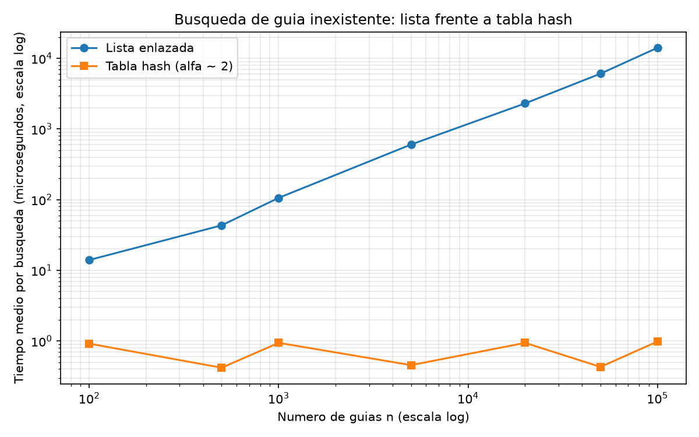
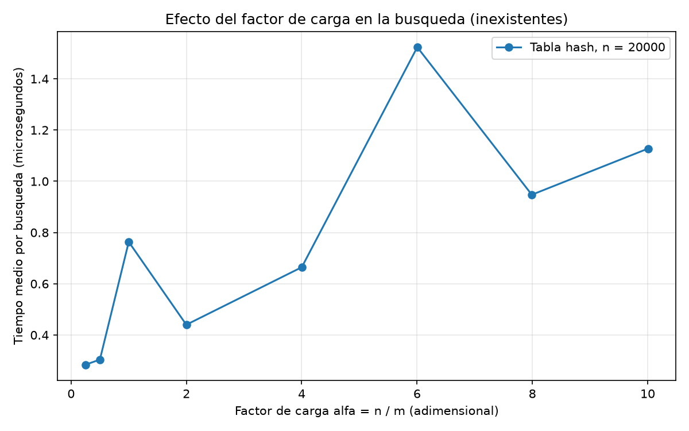

# Laboratorio evaluativo 03 — Estructuras de Datos

**Nombre completo:** DAVID MORALES VARGAS

## Instrucciones para reproducir el experimento

1. Ubicarse en la raíz del repositorio del curso y crear el entorno virtual (solo la primera vez):
   ```bash
   python -m venv venv
   ```
   ó (en Windows, si `python` no está en el PATH)
   ```bash
   py -m venv venv
   ```
2. Activar el entorno virtual:
   - Linux/macOS: `source venv/bin/activate`
   - Windows: `venv\Scripts\activate`
3. Instalar las dependencias (como `matplotlib`):
   ```bash
   pip install -r requirements.txt
   ```
4. Entrar a la carpeta del laboratorio:
   ```bash
   cd laboratorios/lab3-estructuras-datos
   ```
5. Ejecutar las pruebas (el script termina imprimiendo `Todas las pruebas pasaron.`):
   ```bash
   python pruebas.py
   ```
   ó `py pruebas.py` (Para Windows)
6. Ejecutar la medición (imprime los datos y genera `graficas/lista_vs_tabla.png` y `graficas/tiempo_vs_alfa.png`):
   ```bash
   python medicion.py
   ```
   ó `py medicion.py` (Para Windows)

---


## Parte 1 — Implementar y verificar las dos estructuras

Código: [`estructuras.py`](estructuras.py) · Pruebas: [`pruebas.py`](pruebas.py)

`ListaEnlazada` inserta al inicio en Θ(1) y busca con un ciclo `while`. `TablaHash` usa encadenamiento: cada casilla es una `ListaEnlazada` y la función hash es `guia % m`.

`pruebas.py` verifica con `assert`:

- Búsqueda exitosa e infructuosa en la lista, en la tabla y en una lista vacía.
- **Colisión forzada** con `m = 7`: las guías `10`, `24` y `17` caen en la casilla 3, las tres se insertan y se encuentran, y la lista de esa casilla tiene longitud 3 (comprobada recorriéndola y con `tamano`).
- `factor_carga() == 3 / 7` tras esas inserciones.
- **20 colecciones aleatorias** (semilla fija, 1 a 300 guías, `m` entre 1 y 211): lista y tabla devuelven lo mismo para todas las guías existentes y para 50 inexistentes por colección.

---

## Parte 2 — Medir y graficar

Código: [`medicion.py`](medicion.py)

### Experimento A — Lista frente a tabla



### Experimento B — Efecto del factor de carga



### Nota sobre la medición

- Siempre se buscan 200 guías inexistentes (generadas con `generar_guias_inexistentes`, semilla 7) y se reporta el tiempo medio por la búsqueda. Las mismas guías se usan en lista y tabla.
- Solo se cronometran las búsquedas con `time.perf_counter()`. Cada tanda se repite (3 veces la lista, 50 la tabla) y se conserva la menor, para reducir el ruido del sistema.
- En cada configuración se verifica que lista y tabla den el mismo estado en una muestra de 100 guías existentes.
- Experimento A: `m` es el primo más cercano a `n / 2`.
- Los tiempos de la tabla son de décimas de microsegundo, por lo que el ruido del sistema (reloj, caché, otros procesos) es comparable a lo que se mide; por eso su curva oscila.

| n | m | α | Lista (µs) | Tabla (µs) |
|---:|---:|---:|---:|---:|
| 100 | 47 | 2,13 | 14,00 | 0,917 |
| 500 | 251 | 1,99 | 43,32 | 0,419 |
| 1.000 | 499 | 2,00 | 106,00 | 0,942 |
| 5.000 | 2.503 | 2,00 | 602,61 | 0,456 |
| 20.000 | 10.007 | 2,00 | 2.302,55 | 0,940 |
| 50.000 | 24.989 | 2,00 | 6.064,40 | 0,430 |
| 100.000 | 49.999 | 2,00 | 14.109,39 | 0,984 |

- Experimento B: `n = 20.000` y `m` primo cercano a `n / α`.

| m | α | Tabla (µs) |
|---:|---:|---:|
| 79.999 | 0,25 | 0,284 |
| 40.009 | 0,50 | 0,304 |
| 19.997 | 1,00 | 0,763 |
| 10.007 | 2,00 | 0,440 |
| 4.999 | 4,00 | 0,665 |
| 3.331 | 6,00 | 1,523 |
| 2.503 | 7,99 | 0,948 |
| 1.999 | 10,01 | 1,127 |

---

## Parte 3 — Análisis en el README.md

**1. Costo teórico:** Una guía que es inexistente obligaría a la lista a comparar con todos los n nodos antes de llegar a None, sin ninguna información que permita descartar nodos tenemos: Θ(n). En la tabla calcular h(k) cuesta Θ(1) y luego se recorre la lista de esa casilla, cuya longitud esperada es n/m = α, siendo que nos queda un total de Θ(1 + α). Eñ resultado depende de un supuesto de hash uniforme simple, cada guía cae en cualquier casilla con igual probabilidad e independiente de las demás. Si todas fueran a caer en la misma casilla la tabla sería una simple lista de n nodos y las busquedas costarían Θ(n) al igual que la lista original.

**2. Lo medido contra lo esperado:** Entre los datos de n = 50000 y n = 100000 n se duplica, y la lista pasó de 6064,4 a 14109,4 µs : x2,33. Entre los datos n = 20000 y n = 50000 el n se multiplicó por 2,5, siendo que pasó de 2302,55 a 6064,4 µs: x2,63. Ambos factores están cercanos al de n, lo que es coherente con la complejidad algorítmica de Θ(n), y en todo el rango n creció 1000 veces y el tiempo aproximandamente 1000 veces también (14,0 → 14.109 µs). La tabla no sigue a n, entre 20000 y 50000 pasó de 0,940 a 0,430 µs (×0,46) y entre los valores de 50000 y 100000 de 0,430 a 0,984 µs (×2,29), un zigzag que se repite durante toda la curva sin tendencia de crecimiento, con n x 1000 el tiempo pasó de 0,917 a 0,984 µs (×1,07). Esta información es coherente con Θ(1), aunque el ruido (≈ ±0,3 µs) impide afirmar que sea exactamente constante, sería más una aproximación. En la segunda gráfica el tiempo tiende a subir con α: ≈ 0,3 µs con α ≤ 0,5 y ≈ 1,1 µs con α = 10, es decir, ×4 mientras α se multiplicó por 20. Es compatible con Θ(1 + α) (base fija ≈ 0,3 µs más ≈ 0,09 µs por unidad de α), pero la curva no es monótona (α = 1 y α = 6 son picos), así que con estos datos solo puedo sostener la tendencia, no una recta precisa.

**3. Colisiones:** Una colisión ocurre cuando dos guías distintas tienen la misma h(k). Pasa aunque m sea mayor que n (m > n) porque la función comprime un universo de 9·10⁹ guías posibles en m casillas, por palomar, muchas guías comparten casilla, y con un reparto aleatorio las colisiones aparecen mucho antes de llenar la tabla. Ejemplo: con m = 7, 10 mod 7 = 24 mod 7 = 17 mod 7 = 3. Con encadenamiento, las tres quedan en la lista de la casilla 3: es simple, nunca se llena y borrar es fácil, pero cada nodo gasta memoria en un puntero y α puede superar 1. Con direccionamiento abierto (sondeo lineal), el 10 ocupa la casilla 3, el 24 pasa a la 4 y el 17 a la 5: no usa punteros y aprovecha mejor la memoria, pero la tabla no puede pasar de α = 1, las rachas ocupadas se alargan (agrupamiento primario) y borrar exige lápidas para no cortar secuencias de sondeo.

**4. Tabla hash o árbol:** La tabla no sirve para rangos, lo que hace la función hash es repartir las guías sin respetar el orden así que las guías entre X y Y están dispersas por todas las casillas y habría que revisarlas todas, Θ(n + m). Un BST conserva el orden, se baja hasta X en Θ(h) y se recorre en orden hasta Y, Θ(h + k) para k resultados. Pero si las 400.000 guías llegaran ya ordenadas, cada una se colgaría a la derecha de la anterior, el árbol sería una fila de altura h = n − 1 ≈ 400.000 y las inserciones sumarían aproximadamente n²/2 ≈ 8·10¹⁰ comparaciones. En un árbol equilibrado, h ≈ log₂(400.000) ≈ 19 y serían aproximandamente n·log₂n ≈ 7,4·10⁶ comparaciones, unas 10⁴ veces menos. Además, un recorrido recursivo fallaría con RecursionError pasados ~1.000 niveles.

**5. Concepto para la jefa de operaciones:** Recomiendo una combinación de dos estructuras: una tabla hash para la consulta puntual del call center y un árbol de búsqueda balanceado (AVL o rojo-negro, no un BST simple) para el monitoreo por rango, ambos alimentados por las mismas altas. La tabla da Θ(1) esperado y el árbol balanceado garantiza Θ(log n) aunque las guías lleguen ordenadas. Lo que sigue es una estimación para 5.000.000 de envíos. La lista es Θ(n) y mi curva es casi una recta de pendiente 1 en escala log-log (n creció ×1000 y el tiempo ×1008). El costo por nodo osciló entre ≈ 0,09 µs (n = 500) y ≈ 0,14 µs (n = 100.000), con tendencia a subir con n; con 0,14 µs por nodo, 5·10⁶ nodos darían ≈ 0,7 s por búsqueda inexistente. Como con 5·10⁶ nodos la memoria ya no cabe en caché, espero entre 0,7 y 2 s. La tabla, con m proporcional a n y α ≈ 2, debería seguir en Θ(1): entre 0,4 y 1,0 µs en mis datos, quizá 0,5 a 2 µs por fallos de caché, es decir, del orden de 10⁶ veces más rápida. La mayor incertidumbre es el efecto de la memoria, que mi medición (hasta n = 100.000) no alcanza a observar.


